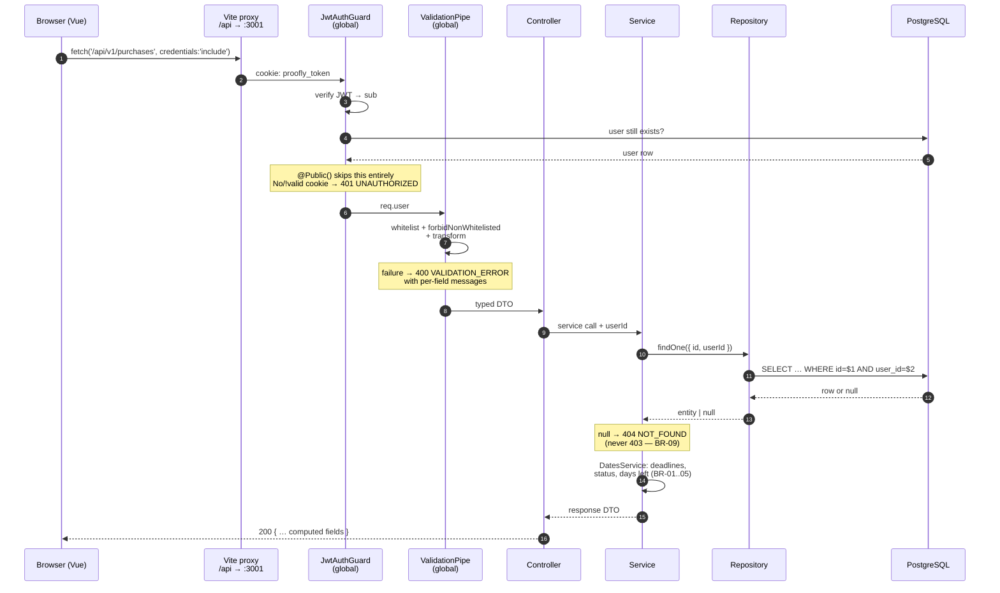
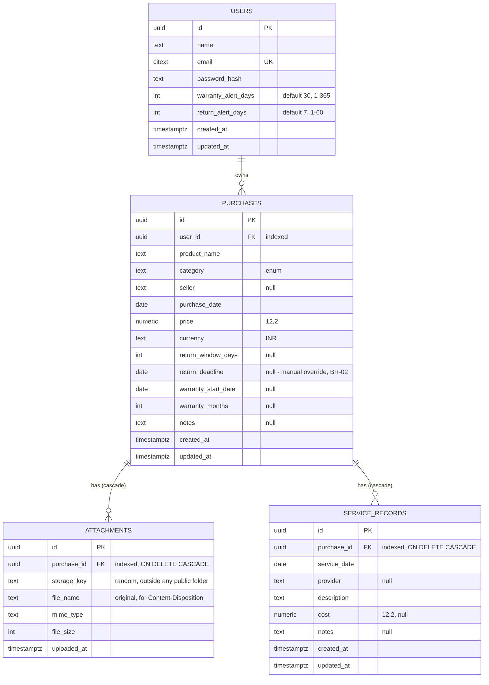

# Proofly — Architecture

A two-app monorepo: a NestJS + TypeORM API over PostgreSQL, and a Vue 3 SPA.
No deployment target — everything runs locally (D-07).

```
Payment_Pal/
├── apps/api/          NestJS 11, TypeORM 0.3, CommonJS, TS strict
├── apps/web/          Vue 3 + Vite 6 + Pinia + Tailwind v4, ESM
├── e2e/               Playwright, both apps running
├── gates/             the phase gate runner and its own tests
├── docs/              requirements, plan, test cases, these documents
└── design/            UI guide, wireframes, mockups
```

---

## 1. Request flow

Every authenticated request passes the same five stages. The guard runs before
validation, so an unauthenticated caller never reaches a DTO.



**Anything thrown** — by the guard, the pipe, a service or an unexpected bug —
is caught by one global exception filter and rendered as:

```json
{ "error": { "code": "VALIDATION_ERROR", "message": "…", "fields": { "price": "…" } } }
```

An unrecognised error becomes `500 INTERNAL` with no stack trace and no detail.
The web client turns that envelope back into a typed `ApiError`
(`apps/web/src/api/client.ts`), which is what every page renders.

---

## 2. Backend layout

`apps/api/src/`

| Module | Owns |
| --- | --- |
| `auth/` | register, login, logout, `/auth/me`; bcrypt; JWT in an httpOnly cookie; the global guard and `@Public()` / `@CurrentUser()` decorators |
| `users/` | `PATCH /users/me/settings` — the two alert windows |
| `purchases/` | CRUD, list with search/filter/sort/pagination, the computed fields |
| `attachments/` | upload, download, delete; MIME + magic-byte checks |
| `service-records/` | repair and service history under an owned purchase |
| `dashboard/` | counts, needs-action, recently expired, recent |
| `health/` | `GET /health` — process plus a database probe |
| `common/dates` | `DatesService` — **every** date rule (BR-01…05) |
| `common/errors` | the global exception filter and the error codes |
| `common/storage` | `StorageService` behind a token; local disk now, S3 later |
| `common/files` | signature (magic-byte) checking |
| `common/filters` | shared query parsing |
| `repositories/` | one repository per entity; `userId` is a parameter on every method |
| `config/` | `@nestjs/config` with fail-fast validation |
| `database/` | DataSource, entities, migrations (`synchronize: false` everywhere) |

**`setup-app.ts`** applies the global prefix `/api/v1`, the `ValidationPipe`,
`cookie-parser` and CORS. `main.ts` and the e2e suite both call it, so the tests
exercise the same pipeline the browser does.

**Two injection tokens** make the awkward parts testable: `CLOCK` (tests fix
"today") and `STORAGE` (tests use a temp directory).

### Endpoints

All under `/api/v1`. Every one except the first two requires the cookie.

| Method | Path | |
| --- | --- | --- |
| POST | `/auth/register` · `/auth/login` | public |
| POST | `/auth/logout` | clears the cookie |
| GET | `/auth/me` | current user + settings |
| PATCH | `/users/me/settings` | `warrantyAlertDays` 1–365, `returnAlertDays` 1–60 |
| GET | `/purchases` | `q`, `category`, `returnStatus`, `warrantyStatus`, `sort`, `page`, `pageSize` |
| POST · GET · PATCH · DELETE | `/purchases` · `/purchases/:purchaseId` | |
| POST | `/purchases/:purchaseId/attachments` | multipart, ≤ 5 MB, ≤ 5 per purchase |
| GET · DELETE | `/attachments/:attachmentId` | streams to the owner only |
| GET · POST | `/purchases/:purchaseId/services` | newest first |
| PATCH · DELETE | `/services/:serviceRecordId` | |
| GET | `/dashboard` | counts, needsAction, recentlyExpired, recent |
| GET | `/health` | `{ status, database }` |

---

## 3. Data model



**There is no status column anywhere.** `returnStatus`, `returnDaysLeft`,
`warrantyExpiry`, `warrantyStatus`, `warrantyDaysLeft` and `hasReceipt` are
computed on every response (BR-04). See `docs/decisions.md` for why, and what it
costs.

**Dates are SQL `DATE`, never timestamps** (BR-05), so a purchase made at 11 pm in
Kolkata is not recorded as the next day. "Today" resolves in `APP_TIMEZONE`
(Asia/Kolkata) on both sides (D-10).

**Money is `numeric(12,2)`** and crosses the wire as a string. Floating point
cannot represent ₹24,900.10 exactly, and this is a record of what someone paid.

---

## 4. Frontend layout

`apps/web/src/`

| | |
| --- | --- |
| `pages/` | Dashboard, Purchases, PurchaseForm, PurchaseDetails, Settings, Login, Register |
| `components/` | `StatusBadge`, `BaseButton`, the inputs, `ErrorSummary`, `EmptyState`, `Skeleton`, `ConfirmDialog`, `Toast`, `AppShell` |
| `stores/auth.ts` | the only Pinia store — session and the user's alert settings |
| `api/client.ts` | one fetch wrapper: `credentials: 'include'`, error envelope → `ApiError` |
| `lib/deadlines.ts` | BR-01/BR-02 in the browser, for the form's live preview |
| `lib/format.ts` | `27 Oct 2026`, `₹24,900.00` |
| `router/` | async guards that return a route; `?redirect=` round-trip |

Search, filters and sort live in the **URL query**, not in a store, so a filtered
list survives a refresh and can be shared.

`AppShell` is a sidebar at ≥ 1024 px and a bottom tab bar below. Tailwind v4 with
the `@theme` tokens copied from `design/ui-guide.md` §2 — no `tailwind.config.js`,
no raw hex in any component.

---

## 5. How the pieces run

```
Browser :5173 ──▶ Vite dev server ──proxy /api──▶ Nest :3000 ──▶ Postgres :5434
                   (apps/web)                      (apps/api)      (docker-compose)
```

The proxy means the browser only ever talks to one origin, so the auth cookie is
same-site and CORS never comes up in development. `VITE_API_TARGET` overrides the
proxy target when the API runs on a different port.

---

## 6. Testing

| Layer | Tool | Count | What it proves |
| --- | --- | --- | --- |
| Unit | Jest | 25 | `DatesService` — every BR-01…05 case, month-end clamp, leap day, boundaries |
| API e2e | Jest + Supertest | 107 | the real pipeline against a real `proofly_test` database, truncated between tests, clock fixed |
| Component | Vitest + Vue Test Utils | 140 | behaviour through the DOM; no snapshot-only tests |
| Browser | Playwright | 17 | the seven journeys, a 390 px viewport, and the accessibility checklist |
| The gate | `node:test` | 22 | that `gates/checks.mjs` refuses what it should |

**289 tests**, each named with its case ID from `docs/test-cases.md`. The gate
(`npm run gate day7`) fails if any ID has no test, if any test fails, or if an
area's first commit was `feat(` rather than `test(`.
